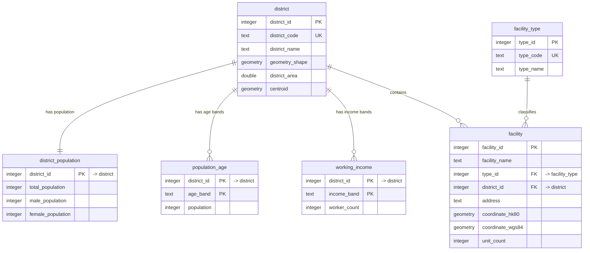

# Querying `lsgi3245_fp`

All geometry is stored in **EPSG:2326** (HK1980 Grid, metres) except `facility.coordinate_wgs84`, which is **EPSG:4326**. `district_area` is km² and `unit_count` may be `NULL`.

## 1. `district_id` → `district_code` → `district_name`

`district_id` is the HKDistrict18 feature ID and is what the foreign keys use. Write queries against `district_code` instead of memorising IDs, and let a join translate it.

| `district_id` | `district_code` | `district_name` |
| ---: | --- | --- |
| 1 | `wong_tai_sin` | WONG TAI SIN |
| 2 | `islands` | ISLANDS |
| 3 | `kwai_tsing` | KWAI TSING |
| 4 | `sham_shui_po` | SHAM SHUI PO |
| 5 | `yau_tsim_mong` | YAU TSIM MONG |
| 6 | `kowloon_city` | KOWLOON CITY |
| 7 | `kwun_tong` | KWUN TONG |
| 8 | `sai_kung` | SAI KUNG |
| 9 | `tai_po` | TAI PO |
| 10 | `sha_tin` | SHA TIN |
| 11 | `north` | NORTH |
| 12 | `tsuen_wan` | TSUEN WAN |
| 13 | `central_and_western` | CENTRAL & WESTERN |
| 14 | `wan_chai` | WAN CHAI |
| 15 | `eastern` | EASTERN |
| 16 | `southern` | SOUTHERN |
| 17 | `tuen_mun` | TUEN MUN |
| 18 | `yuen_long` | YUEN LONG |

## 2. `type_id` → `type_code` → `type_name`

`facility_type` follows the same pattern for facility categories.

| `type_id` | `type_code` | `type_name` |
| ---: | --- | --- |
| 1 | `badminton_courts` | Badminton Courts |
| 2 | `basketball_courts` | Basketball Courts |
| 3 | `country_parks` | Country Parks |
| 4 | `fitness_rooms` | Fitness Rooms |
| 5 | `parks_zoos_and_gardens` | Parks, Zoos and Gardens |
| 6 | `sports_grounds` | Sports Grounds |
| 7 | `swimming_pools` | Swimming Pools |
| 8 | `tennis_courts` | Tennis Courts |

## 3. Query by code instead of ID

### `NATURAL JOIN`

Each pair of related tables shares **exactly one** column name: `district`, `facility`, `district_population`, `population_age` and `working_income` share `district_id`, while `facility_type` and `facility` share `type_id`. Because of that, `NATURAL JOIN` needs no `ON` clause.

```sql
-- facilities in a district, selected by code
SELECT facility_name, type_code
FROM facility
NATURAL JOIN district
NATURAL JOIN facility_type
WHERE district_code = 'sha_tin';
```

```sql
-- facilities per category, selected by code
SELECT type_name, count(*) AS facility_count
FROM facility
NATURAL JOIN facility_type
WHERE type_code IN ('swimming_pools', 'tennis_courts')
GROUP BY type_name
ORDER BY facility_count DESC;
```

```sql
-- population and facility count per district
SELECT district_code, total_population, count(facility_id) AS facility_count
FROM district
NATURAL JOIN district_population
LEFT JOIN facility USING (district_id)
GROUP BY district_code, total_population
ORDER BY total_population DESC;
```

Natural joins are implicit: adding an identically named column later silently changes the join condition. Prefer the explicit forms below in queries you keep.

### Explicit `JOIN … USING` / `JOIN … ON`

```sql
SELECT d.district_code, count(*) AS facility_count
FROM facility AS f
JOIN district AS d USING (district_id)
GROUP BY d.district_code
ORDER BY facility_count DESC;
```

```sql
-- district and category names for matching facilities
SELECT f.facility_name, t.type_name, d.district_name
FROM facility AS f
JOIN facility_type AS t ON t.type_id = f.type_id
JOIN district      AS d ON d.district_id = f.district_id
WHERE f.facility_name ILIKE '%sports centre%'
LIMIT 10;
```

### A code as a subquery, when no join is wanted

```sql
SELECT facility_name, unit_count
FROM facility
WHERE district_id = (SELECT district_id FROM district WHERE district_code = 'islands')
  AND unit_count >= 4
ORDER BY unit_count DESC;
```

### Codes with the statistical tables

`population_age` and `working_income` store the readable band in each row, so a code filter plus `GROUP BY` is all that is needed.

```sql
-- age structure of two districts
SELECT d.district_code, a.age_band, a.population
FROM population_age AS a
JOIN district AS d USING (district_id)
WHERE d.district_code IN ('kwun_tong', 'sha_tin')
ORDER BY d.district_code, a.age_band;
```

```sql
-- share of workers earning 40,000 and above, per district
SELECT d.district_code,
       round(
           100.0 * sum(w.worker_count)
                   FILTER (WHERE w.income_band IN ('income_40000_59999', 'income_60000_and_over'))
           / nullif(sum(w.worker_count), 0),
           2
       ) AS pct_high_income
FROM working_income AS w
JOIN district AS d USING (district_id)
GROUP BY d.district_code
ORDER BY pct_high_income DESC NULLS LAST;
```

### Spatial queries by code

```sql
-- facilities whose point falls inside a district polygon
SELECT f.facility_name, f.coordinate_hk80
FROM facility AS f
JOIN district AS d USING (district_id)
WHERE d.district_code = 'yau_tsim_mong'
  AND ST_Contains(d.geometry_shape, f.coordinate_hk80);
```

```sql
-- metres from a HK1980 Grid point to each district centroid
SELECT district_code,
       round(ST_Distance(centroid, ST_GeomFromText('POINT(836000 820000)', 2326))) AS metres
FROM district
ORDER BY metres
LIMIT 5;
```

### Views

| View | One row per | Use it for |
| --- | --- | --- |
| `district_spatial_summary` | district | stored vs. recalculated area / centroid, label point |
| `facility_coordinates` | facility | easting / northing, WGS84 geometry, longitude / latitude |
| `facility_details` | facility | facility plus `type_code`, `type_name`, `district_code`, `district_name` |

```sql
SELECT district_code, stored_area_km2, calculated_area_km2
FROM district_spatial_summary
ORDER BY district_code
LIMIT 5;

SELECT facility_name, type_name, district_code, longitude, latitude
FROM facility_details
NATURAL JOIN facility_coordinates
WHERE district_code = 'tai_po'
LIMIT 10;
```

## 4. Schema

### Tables

| Table | Rows | Description |
| --- | ---: | --- |
| `district` | 18 | District polygons (`geometry_shape`, EPSG:2326) with stored `district_area` (km²) and `centroid`. Key: `district_id`. |
| `facility_type` | 8 | Category lookup: `type_id` → `type_code` → `type_name`. |
| `facility` | 774 | One point per facility with both coordinate systems and an optional `unit_count`. Key: `facility_id`. |
| `district_population` | 18 | Total, male and female population per district. Key: `district_id`. |
| `population_age` | 90 | Five age bands per district. Key: (`district_id`, `age_band`). |
| `working_income` | 126 | Seven income bands per district. Key: (`district_id`, `income_band`). |

`district`:

| Column | Type | Notes |
| --- | --- | --- |
| `district_id` | `integer` | PK, 1…18 |
| `district_code` | `text` | UNIQUE, matches `^[a-z][a-z0-9_]*$` |
| `district_name` | `text` | display name |
| `geometry_shape` | `geometry(MultiPolygon, 2326)` | NOT NULL, `ST_IsValid` enforced |
| `district_area` | `double precision` | NOT NULL, km² |
| `centroid` | `geometry(Point, 2326)` | may be `NULL` |

`facility`:

| Column | Type | Notes |
| --- | --- | --- |
| `facility_id` | `integer` | PK, `GENERATED ALWAYS AS IDENTITY` |
| `facility_name` | `text` | NOT NULL |
| `type_id` | `integer` | FK → `facility_type`, `ON DELETE RESTRICT` |
| `district_id` | `integer` | FK → `district`, `ON DELETE RESTRICT` |
| `address` | `text` | may be `NULL` |
| `coordinate_hk80` | `geometry(Point, 2326)` | NOT NULL, GiST indexed |
| `coordinate_wgs84` | `geometry(Point, 4326)` | NOT NULL, loaded from the CSV |
| `unit_count` | `integer` | may be `NULL`, `>= 0` |

Band values are constrained: `age_band` is one of `<15`, `15-24`, `25-44`, `45-64`, `65+`; `income_band` is one of `income_under_6000`, `income_6000_9999`, `income_10000_19999`, `income_20000_29999`, `income_30000_39999`, `income_40000_59999`, `income_60000_and_over`.

### Entity-relationship diagram



The three views are read-only projections over these tables: `district_spatial_summary` (from `district`), `facility_coordinates` (from `facility`) and `facility_details` (`facility` + `facility_type` + `district`).

## 5. Quick check

```sql
SELECT 'district' AS tbl, count(*) FROM district
UNION ALL SELECT 'facility_type', count(*) FROM facility_type
UNION ALL SELECT 'facility', count(*) FROM facility
UNION ALL SELECT 'district_population', count(*) FROM district_population
UNION ALL SELECT 'population_age', count(*) FROM population_age
UNION ALL SELECT 'working_income', count(*) FROM working_income;
-- 18 | 8 | 774 | 18 | 90 | 126
```
